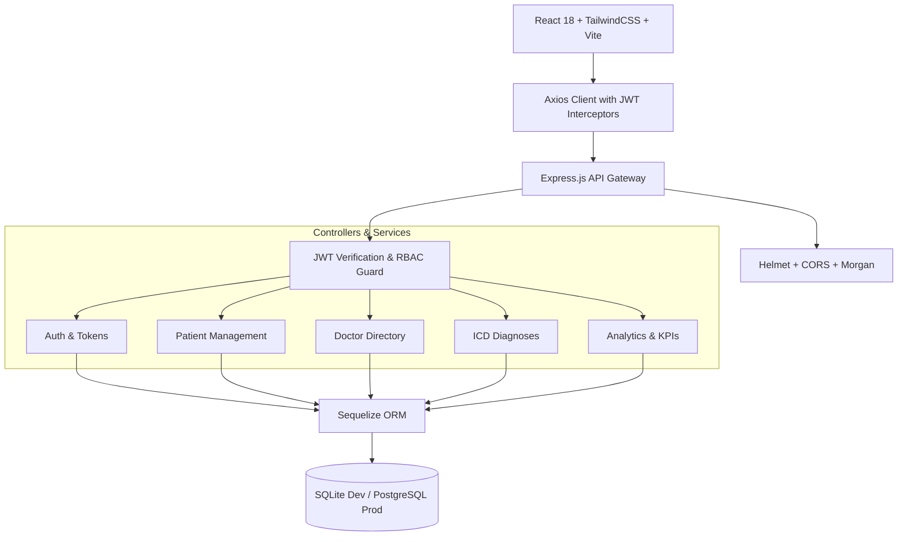

# 🏥 CareTrack: Enterprise Clinic Medical Records Management System (MRMS)

[](https://react.dev)
[](https://nodejs.org)
[](https://tailwindcss.com)
[-52B0E7.svg?logo=sequelize&logoColor=white)](https://sequelize.org)
[](LICENSE)

> A modern, secure, and compliant full-stack Medical Records Management System (MRMS) designed for outpatient clinics and healthcare facilities. Features fine-grained Role-Based Access Control (RBAC), patient history tracking, ICD-coded diagnostic management, and executive clinical analytics.

---

## 🏗️ System Architecture



---

## 🔐 Role-Based Access Control (RBAC) Matrix

| Resource / Action | Administrator (`admin`) | Clinician (`clinician`) | Receptionist (`receptionist`) |
| :--- | :---: | :---: | :---: |
| **System Dashboard & Financials** | Full Access | Clinical Stats Only | Queue Stats Only |
| **Doctor Directory & Staff Management** | Full CRUD | Read-Only | Read-Only |
| **Patient Registration & Intake** | Full Access | Read-Only | Create & Read |
| **Medical Records & Diagnoses (ICD)** | Full Access | Full CRUD (Treating Doctor) | ❌ Restricted |
| **User Role Assignment & Security** | Full Access | ❌ Restricted | ❌ Restricted |

---

## 🌟 Key Functional Modules

- **Patient Registration & Electronic Health Records (EHR):** Comprehensive demographic, contact, and blood group profiling with search and pagination.
- **Clinical Diagnoses (ICD Classification):** Structured diagnostic recording linked directly to attending physicians, incorporating standard ICD codes and notes.
- **Real-Time Clinical Telemetry & Analytics:** Recharts-powered interactive analytics displaying patient inflow, department utilization, and diagnostic distributions.
- **Dual Database Flexibility:** Configured out of the box with zero-setup **SQLite**, seamlessly portable to production **PostgreSQL** via `.env` configuration.
- **Automated Validation:** Strict payload validation on both frontend (React Hook Form) and backend (Express Validator).

---

## 📂 Project Structure

```
caretrack-clinic-mrms/
├── backend/
│   ├── src/
│   │   ├── config/              # Database (Sequelize) & JWT settings
│   │   ├── controllers/         # Business logic (auth, patient, doctor, diagnosis)
│   │   ├── middleware/          # JWT auth, RBAC guards, error handling
│   │   ├── models/              # Sequelize schemas (User, Patient, Doctor, Diagnosis)
│   │   ├── routes/              # Express API endpoints
│   │   ├── seeders/             # Automated demo data seeder
│   │   └── server.js            # Entrypoint
│   ├── .env.example
│   └── package.json
├── frontend/
│   ├── src/
│   │   ├── api/                 # Axios clients and API bindings
│   │   ├── components/          # Reusable UI, Layout, RoleGuard, ProtectedRoute
│   │   ├── pages/               # Dashboard, Patients, Doctors, Diagnoses, Login
│   │   ├── store/               # Zustand authentication store
│   │   └── main.jsx
│   ├── package.json
│   └── tailwind.config.js
├── tests/
│   └── api_test.sh              # Automated curl-based API integration tests
├── .gitignore
└── README.md
```

---

## 🚀 Quickstart & Installation

### 1. Clone the Repository
```bash
git clone https://github.com/Az1zbekx/caretrack-clinic-mrms.git
cd caretrack-clinic-mrms
```

### 2. Backend Setup
```bash
cd backend
cp .env.example .env
npm install
npm run seed       # Populates doctors, demo patients, and staff accounts
npm run dev        # Starts backend on http://localhost:5001
```

### 3. Frontend Setup
In a new terminal:
```bash
cd frontend
npm install
npm run dev        # Starts Vite dev server on http://localhost:3000
```

---

## 🔑 Pre-Seeded Demo Credentials

| Role | Email | Password |
| :--- | :--- | :--- |
| **Administrator** | `admin@caretrack.uz` | `Admin123!` |
| **Clinician / Doctor** | `doctor@caretrack.uz` | `Doctor123!` |
| **Receptionist** | `reception@caretrack.uz` | `Reception123!` |

---

## 🧪 Automated API Testing

Verify backend routes and security token flows using the included test suite:
```bash
bash tests/api_test.sh
```

---

## 👤 Author

- **Developer:** [Azizbek (Az1zbekx)](https://github.com/Az1zbekx)
- **License:** MIT
